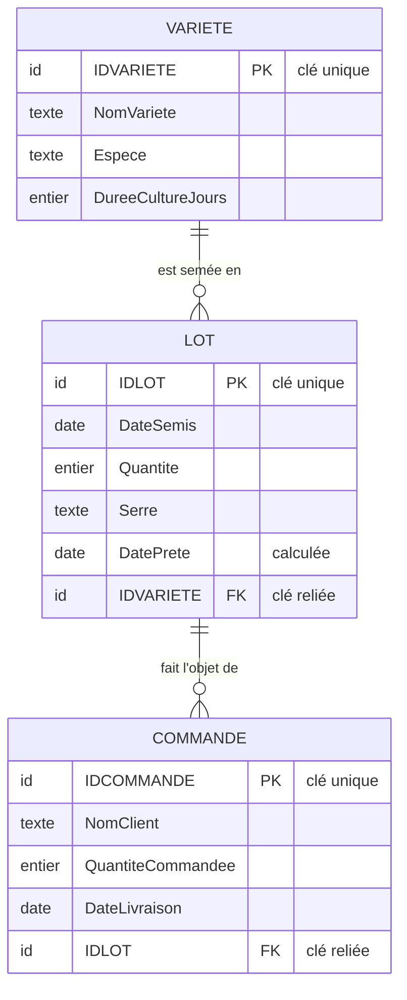
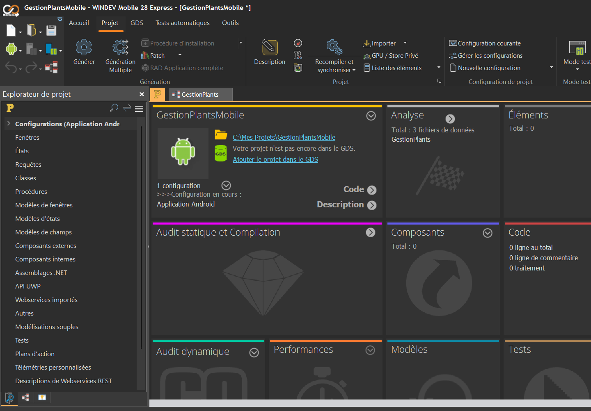
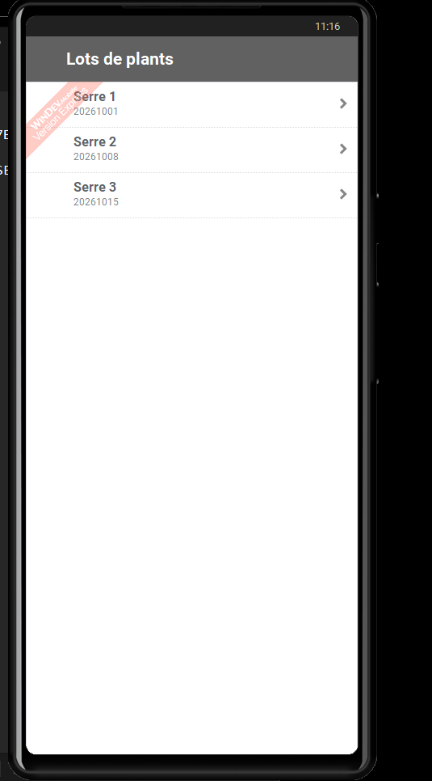

# GestionPlants – Application WinDev / HFSQL

Application Windows de gestion de production de **plants maraîchers** : variétés, lots semés et commandes clients.
Réalisée avec **WinDev 28 Express** (PC SOFT) et une base **HFSQL Classic**, pour prendre en main l'environnement PC SOFT.


## En bref

| Élément | Détail |
| --- | --- |
| Outils | WinDev 28 Express et WinDev Mobile 28 Express (PC SOFT) |
| Langage | WLangage |
| Base de données | HFSQL Classic |
| Fichiers de données | 3 : VARIETE, LOT, COMMANDE |
| Liaisons | 2, avec intégrité référentielle |
| Généré par le RAD | 11 fenêtres, 1 fenêtre interne, 6 états, 1 menu |
| Code métier | Calcul automatique de la date prête à livrer |
| Durée | 1 journée |

## Fonctionnalités

- **Variétés** de plants avec leur durée de culture (Batavia : 35 jours, Black Beauty : 45 jours…).
- **Lots** semés : date de semis, quantité, serre, et **date prête calculée automatiquement**.
- **Commandes clients** rattachées à un lot.
- **Intégrité référentielle** : impossible de supprimer une variété qui a encore des lots.
- **États imprimables** : liste des lots, des commandes, des variétés.
- **FAA** (Fonctionnalités Automatiques de l'Application) : export Excel/Word, tri et filtres sans code.

## Modèle de données




## Code WLangage

Fiche LOT, traitement « Sortie de SAI_DateSemis » :

```wlanguage
// Calcule la date prête = date de semis + durée de culture de la variété
HLitRecherchePremier(VARIETE, IDVARIETE, COMBO_VARIETE)
SI HTrouve(VARIETE) ET SAI_DateSemis <> "" ALORS
	SAI_DatePrete = DateVersChaîne(EntierVersDate(DateVersEntier(SAI_DateSemis) + VARIETE.DureeCultureJours), "AAAAMMJJ")
FIN
```

Détail dans [code/FEN_Fiche_LOT_SAI_DateSemis.wl](code/FEN_Fiche_LOT_SAI_DateSemis.wl).

## Tests

| Test | Résultat |
| --- | --- |
| Compilation du projet | « Compilation terminée », aucune erreur bloquante |
| Lot Black Beauty, semis 20/10/2026 | Date prête calculée : 04/12/2026 (+45 jours) |
| Suppression d'une variété qui a un lot | Refusée : « Intégrité non respectée » |


## Étapes du projet en images

| Étape | Captures | Contenu |
| --- | --- | --- |
| 1. Installation et activation | 01 – 04 | Activation de WinDev Express, imprimante par défaut, écran d'accueil |
| 2. Création du projet | 05 – 11 | Plateforme, charte de programmation, gabarit, langue, base de données |
| 3. Analyse et fichiers | 12 – 18 | Analyse HFSQL, fichiers VARIETE, LOT, COMMANDE et leurs rubriques |
| 4. Liaisons | 19 – 23 | Cardinalités, clé reliée, règles d'intégrité |
| 5. Génération | 24 – 29 | Analyse v1, RAD application complète, tableau de bord du projet |
| 6. États | 30 – 34 | Erreurs d'UI, correction des libellés, compilation |
| 7. Tests | 35 – 41 | Application, intégrité refusée, date prête calculée |

| | | |
| --- | --- | --- |
|  |  |  |
|  |  |  |

## Application mobile Android

Une application **WinDev Mobile** réutilise **la même analyse HFSQL** : liste des lots sur téléphone (zone répétée liée au fichier LOT), données créées en WLangage, testée dans le simulateur Android.

| | |
| --- | --- |
|  |  |

Détail pas à pas avec 20 captures : [docs/WINDEV_MOBILE.md](docs/WINDEV_MOBILE.md)

## Documentation

- [Application mobile Android pas à pas](docs/WINDEV_MOBILE.md)
- [Documentation pas à pas](docs/DOCUMENTATION.md) : installation, construction, tests, problèmes rencontrés.
- [Glossaire et formes complètes](docs/GLOSSAIRE.md) : HFSQL, RAD, FAA, GDS, MLD…
- [Captures d'écran](screenshots/) : les 41 étapes du projet, de l'installation au test final.

## Améliorations prévues

- Recalcul de la date prête quand la variété change (procédure locale).
- Message d'intégrité métier avec `HSurErreur`.
- Contrôle de la quantité restante d'un lot avant commande.
- Passage en HFSQL Client/Serveur pour un usage multi-postes.
- Écran WinDev Mobile de consultation d'un lot sur terminal Android.
- Tableau de bord Power BI branché sur HFSQL via ODBC.

## Auteur

**Ankit Rastogi** – Flowbotics · Maillane (13)
Analyste programmeur, développement d'applications de gestion, bases de données et BI.

> Projet d'apprentissage réalisé avec la version Express gratuite de WinDev (filigrane « Version Express » sur les captures).
