# Documentation pas à pas – GestionPlants

[← Retour au README](../README.md) · [Glossaire](GLOSSAIRE.md)

Ce document retrace **toutes les étapes** du projet, dans l'ordre réel, avec les **41 captures d'écran** prises pendant la réalisation (filigrane « Version Express » : version gratuite de WinDev).

## Sommaire

1. [Objectif](#1-objectif)
2. [Installation et activation](#2-installation-et-activation) – captures 01 à 04
3. [Créer le projet](#3-créer-le-projet) – captures 05 à 11
4. [Créer l'analyse et les fichiers](#4-créer-lanalyse-et-les-fichiers) – captures 12 à 18
5. [Créer les liaisons](#5-créer-les-liaisons) – captures 19 à 23
6. [Générer l'analyse](#6-générer-lanalyse) – capture 24
7. [Générer l'application avec le RAD](#7-générer-lapplication-avec-le-rad) – captures 25 à 29
8. [Corriger les états](#8-corriger-les-états) – captures 30 à 34
9. [Tester l'application](#9-tester-lapplication) – captures 35 à 39
10. [Ajouter le code métier](#10-ajouter-le-code-métier) – captures 40 et 41
11. [Bilan des tests](#11-bilan-des-tests)
12. [Problèmes rencontrés et solutions](#12-problèmes-rencontrés-et-solutions)
13. [Améliorations possibles](#13-améliorations-possibles)

---

## 1. Objectif

Construire en une journée une petite application de gestion de production de plants maraîchers, pour prendre en main WinDev, WLangage et HFSQL :

- **Variétés** de plants et leur durée de culture.
- **Lots** semés, avec date prête à livrer calculée automatiquement.
- **Commandes clients** rattachées à un lot.

---

## 2. Installation et activation

WinDev Express est gratuit et sans limite de durée ; les applications créées se ferment après environ une heure (usage d'apprentissage uniquement).

### Étape 2.1 – Télécharger et installer

Télécharger **WinDev Express** sur pcsoft.fr ou windev.com, puis installer avec les options par défaut, **en français** (pour que les menus et les fonctions WLangage correspondent à ceux d'une entreprise française).

### Étape 2.2 – Activer WinDev Express

Au premier lancement, WinDev demande une activation en trois étapes :

1. Copier **l'identifiant** affiché (bouton Copier).
2. Ouvrir la page pcsoft.fr/pcsoft/demande/version-express.htm et remplir le formulaire avec cet identifiant.
3. Coller la **clé d'activation** reçue par e-mail (bouton Coller), puis OK.

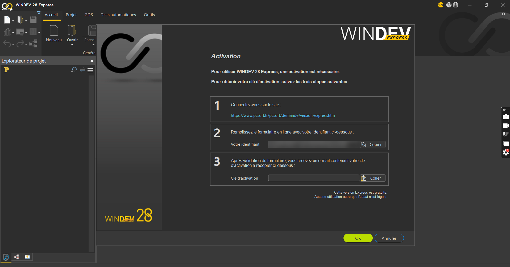

### Étape 2.3 – Gérer l'attente d'imprimante

Pendant l'installation, Windows affiche « Waiting for printer connection » : WinDev interroge l'imprimante par défaut (pour l'éditeur d'états) et celle-ci était hors ligne.

**Solution** : Cancel, puis Paramètres → Bluetooth et appareils → Imprimantes et scanners → désactiver « Laisser Windows gérer mon imprimante par défaut » → définir **Microsoft Print to PDF** par défaut.

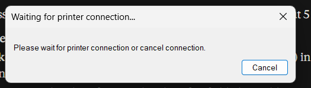

### Étape 2.4 – Recevoir la clé

Le formulaire PC SOFT confirme l'envoi de la clé par e-mail (vérifier aussi les spams).

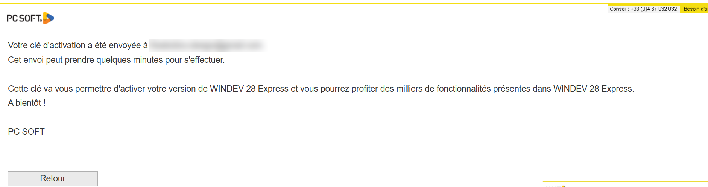

### Étape 2.5 – Écran d'accueil

WinDev est activé. Cliquer sur **Tester immédiatement** ; le tutoriel reste accessible depuis le menu Aide.

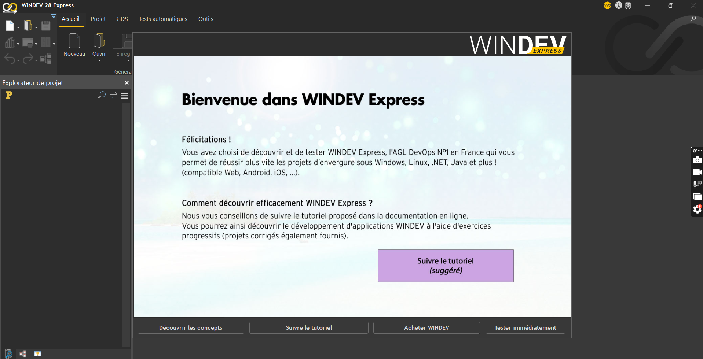

---

## 3. Créer le projet

Accueil → **Nouveau** → **Projet**. L'assistant comporte 5 étapes : Description, Chartes, Internationalisation, Base de données, Fin.

### Étape 3.1 – Plateforme

**Exécutable Windows 32 bits** (fonctionne sur Windows 32 et 64 bits) et **Exécutable avec fenêtres**.

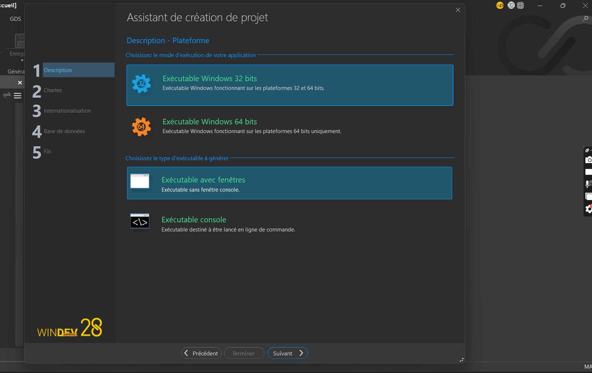

### Étape 3.2 – Nom et emplacement

Nom **GestionPlants**, emplacement par défaut **C:\Mes Projets\GestionPlants**.

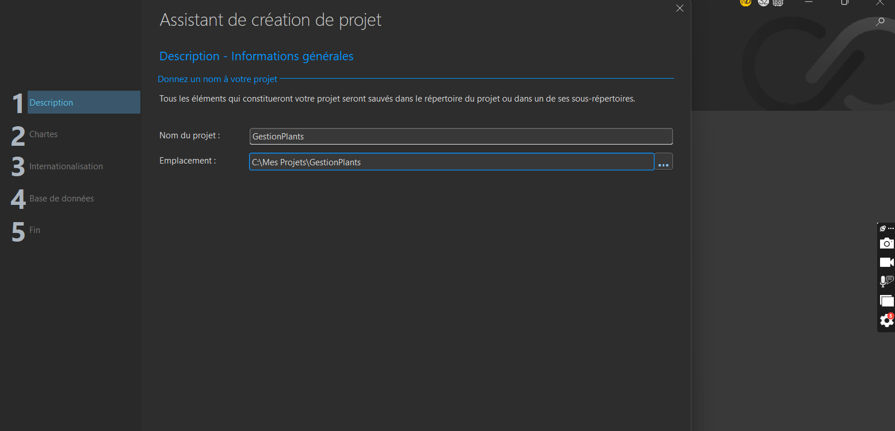

### Étape 3.3 – Documents joints

Aucun document. Cet écran permet de joindre un cahier des charges ou des spécifications au projet : une bonne pratique pour documenter un ERP.

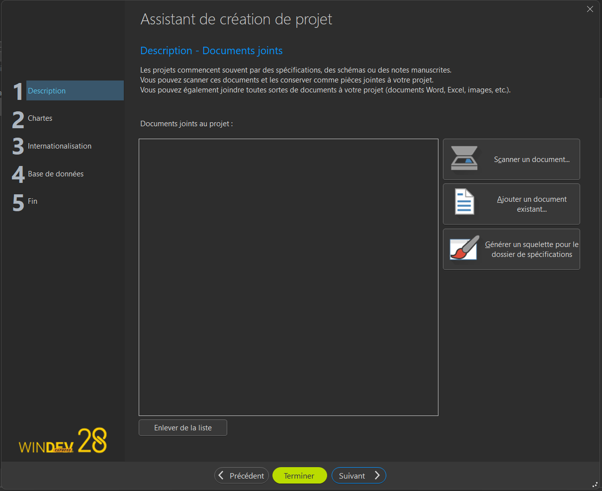

### Étape 3.4 – Charte de programmation

**Oui, charte Standard** : WinDev préfixe automatiquement les noms (SAI_ pour une saisie, COMBO_ pour une liste déroulante, FEN_ pour une fenêtre). Le code est plus lisible et plus facile à maintenir.

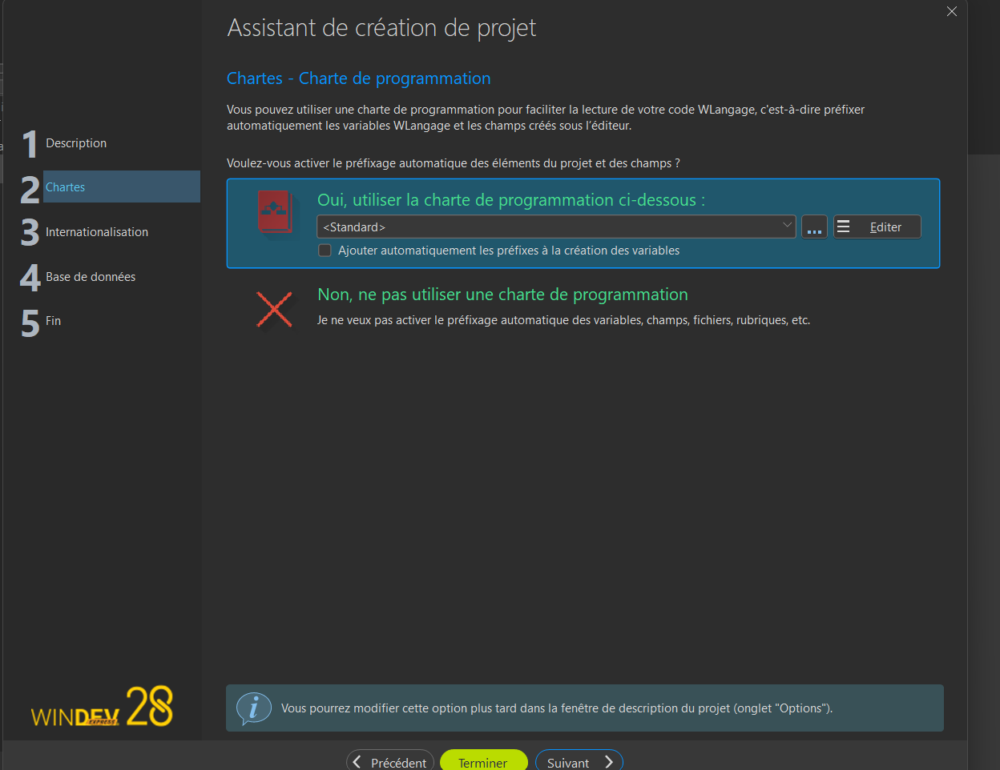

### Étape 3.5 – Charte graphique

Gabarit **Phoenix** : sobre et lisible pour une application de gestion.

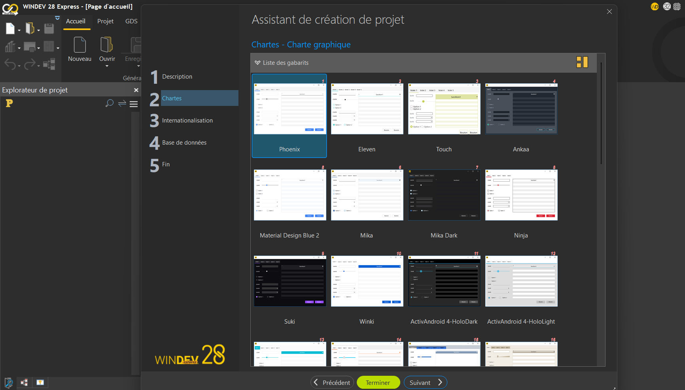

### Étape 3.6 – Langue

**Français** seul. Remarque : les nombres suivent les paramètres régionaux de Windows (ici 12,354.26 en format anglais).

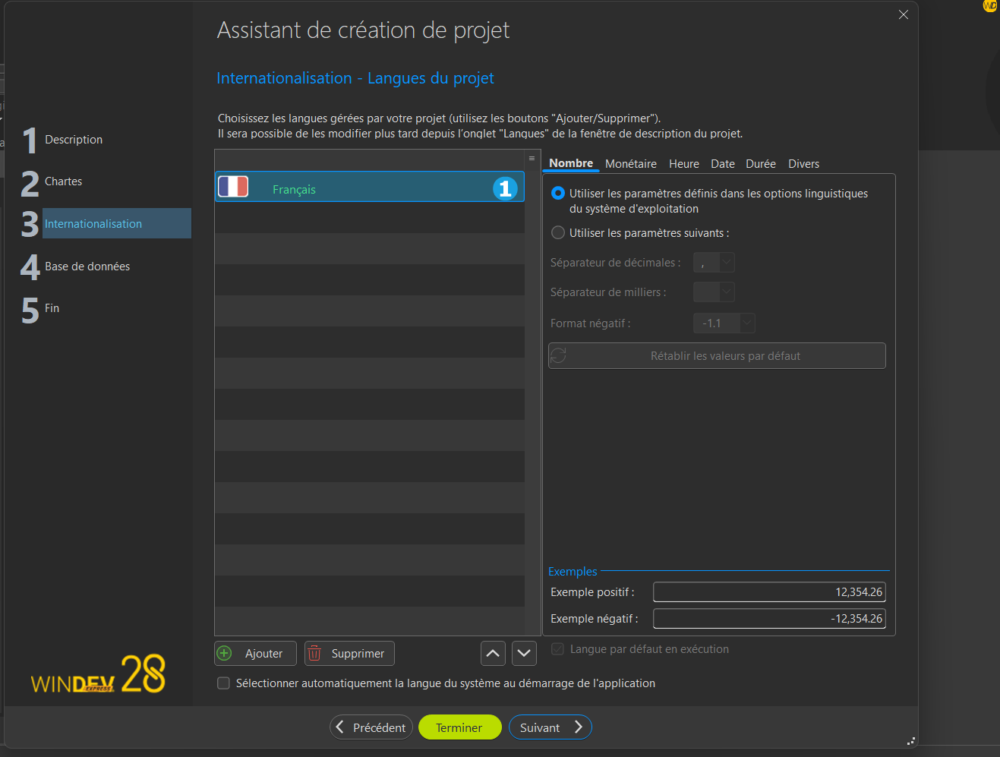

### Étape 3.7 – Base de données

**Oui, créer une nouvelle base de données.** L'option « utiliser une base existante » servirait pour se connecter à une base HFSQL Client/Serveur, Oracle, SQL Server ou MySQL déjà en place.


---

## 4. Créer l'analyse et les fichiers

### Étape 4.1 – Créer l'analyse

Nom **GestionPlants**, type **HFSQL Classic**. La description saisie ici est reprise dans la documentation technique imprimable.

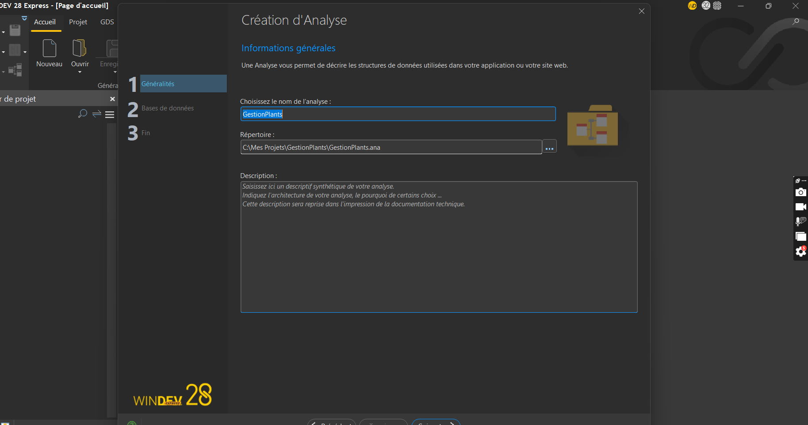

### Étape 4.2 – Créer le fichier VARIETE

Onglet Analyse → **Nouveau fichier** → « Créer une nouvelle description d'un fichier de données », identifiant automatique sur 8 octets.

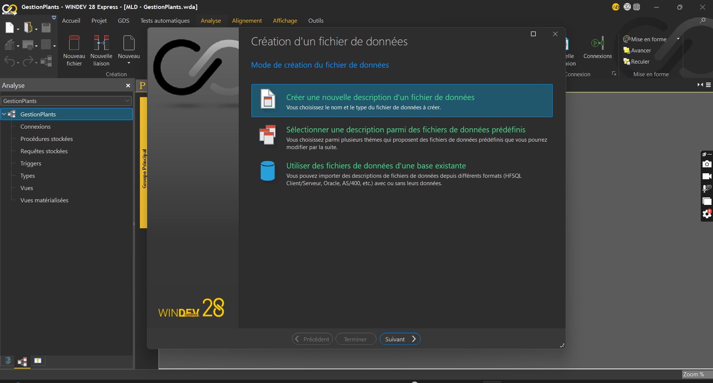

### Étape 4.3 – Rubriques de VARIETE

Une ligne par rubrique ; le type et la clé se règlent dans le panneau de droite.

| Rubrique | Type | Clé |
| --- | --- | --- |
| IDVARIETE | Identifiant automatique (8 octets) | Clé unique |
| NomVariete | Texte 50 | Avec doublons |
| Espece | Texte 30 | Avec doublons |
| DureeCultureJours | Numérique entier (4 octets) | Non clé |


### Étape 4.4 – Attention au bon bouton

Après validation, la fenêtre **Nouveau** générale s'est ouverte (fenêtre, état, requête…). Ce n'est pas la création de fichier : fermer, puis utiliser le bouton **Nouveau fichier** du ruban Analyse.

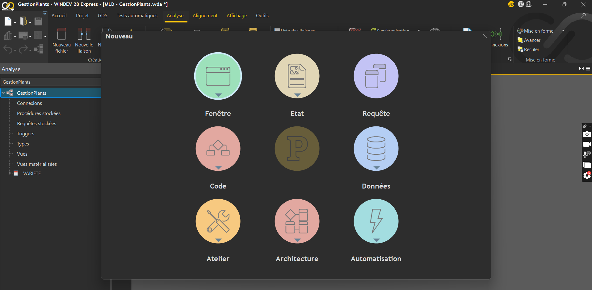

### Étape 4.5 – Rubriques de LOT

IDLOT est créé automatiquement. La clé étrangère IDVARIETE n'est **pas** ajoutée à la main : la liaison la créera avec le bon type.

| Rubrique | Type | Clé |
| --- | --- | --- |
| IDLOT | Identifiant automatique (8 octets) | Clé unique |
| DateSemis | Date | Avec doublons |
| Quantite | Numérique entier | Non clé |
| Serre | Texte 20 | Avec doublons |
| DatePrete | Date | Avec doublons |

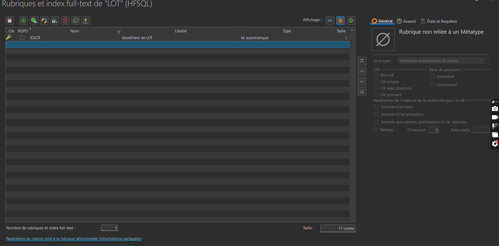

### Étape 4.6 – Fichier COMMANDE

Erreur corrigée : le nom du **fichier** avait été saisi « IDCOMMANDE ». Le fichier s'appelle **COMMANDE** ; l'identifiant IDCOMMANDE est créé automatiquement à partir de ce nom.

| Rubrique | Type | Clé |
| --- | --- | --- |
| IDCOMMANDE | Identifiant automatique (8 octets) | Clé unique |
| NomClient | Texte 50 | Avec doublons |
| QuantiteCommandee | Numérique entier | Non clé |
| DateLivraison | Date | Avec doublons |

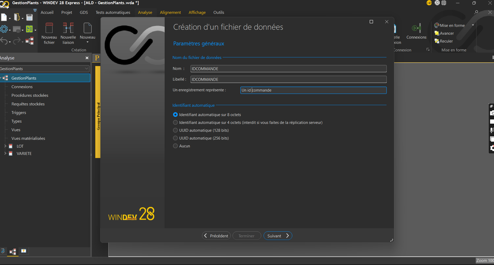

### Étape 4.7 – Les trois fichiers

Les trois fichiers apparaissent dans l'analyse ; les clés sont en gras. Faute de frappe repérée et corrigée ensuite : DateLiveraison → **DateLivraison**.

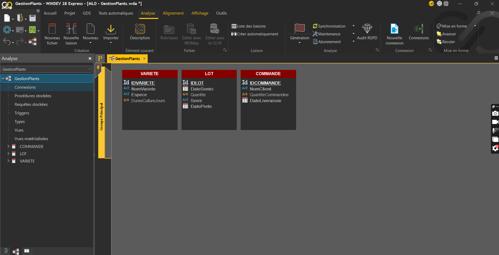

---

## 5. Créer les liaisons

Onglet Analyse → **Nouvelle liaison** → clic sur le fichier parent, puis sur le fichier enfant.

### Étape 5.1 – Cardinalités VARIETE → LOT

L'assistant pose les cardinalités sous forme de questions :

| Question | Réponse |
| --- | --- |
| Chaque variété a au moins un lot ? | Non |
| Chaque variété peut avoir plusieurs lots ? | Oui |
| Chaque lot a au moins une variété ? | **Oui** (corrigé : la réponse par défaut donnait 0,1) |
| Chaque lot peut avoir plusieurs variétés ? | Non |

Résultat : **VARIETE 0,n → 1,1 LOT**.


### Étape 5.2 – Clé unique utilisée

La liaison s'appuie sur la clé unique **IDVARIETE** du fichier VARIETE.

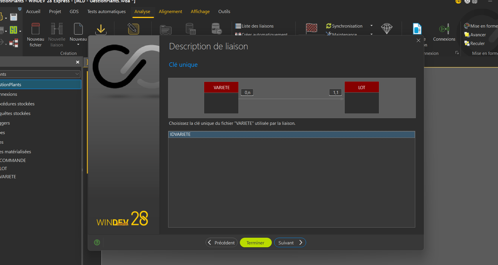

### Étape 5.3 – Clé reliée (migrée)

« Créer une nouvelle clé » IDVARIETE dans LOT : c'est la **clé étrangère**, créée avec le même type que dans VARIETE et en clé avec doublons.

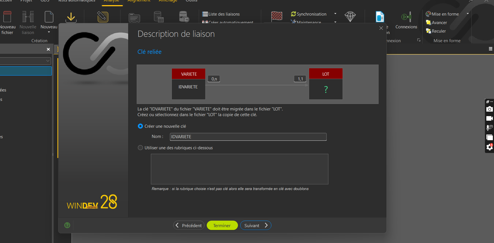

### Étape 5.4 – Règles d'intégrité

- Suppression : **interdire** la suppression d'une variété qui a au moins un lot.
- Modification : **interdire** la modification de la clé si la variété a des lots.
- Nom de la liaison : **Contrainte_VARIETE_LOT**.

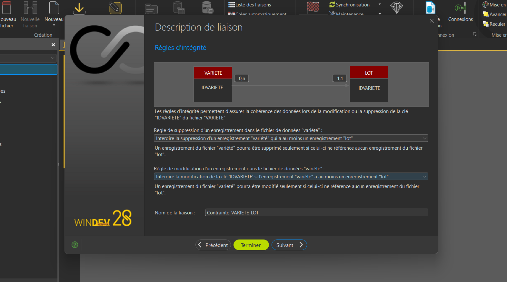

### Étape 5.5 – Analyse complète

Même démarche pour **LOT 0,n → 1,1 COMMANDE** (clé IDLOT migrée dans COMMANDE). Les libellés des liaisons apparaissent sur le schéma.

| Liaison | Parent | Enfant | Clé migrée | Règle |
| --- | --- | --- | --- | --- |
| Contrainte_VARIETE_LOT | VARIETE 0,n | LOT 1,1 | IDVARIETE | Suppression/modification interdites si des lots existent |
| Contrainte_LOT_COMMANDE | LOT 0,n | COMMANDE 1,1 | IDLOT | Suppression/modification interdites si des commandes existent |


---

## 6. Générer l'analyse

Onglet Analyse → **Génération**. Le titre affiche **(v 1)** : chaque génération crée une version de l'analyse, utilisée ensuite pour mettre à jour la structure des fichiers chez les utilisateurs (WDModFic).

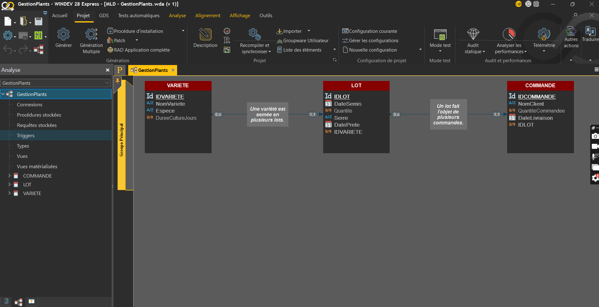

---

## 7. Générer l'application avec le RAD

Onglet Projet → **RAD Application complète**.

### Étape 7.1 – Fichiers

VARIETE, LOT et COMMANDE cochés.


### Étape 7.2 – Points d'entrée

Les trois fichiers : chacun aura son entrée dans le menu principal.

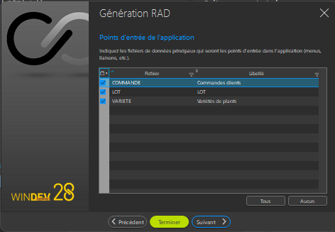

### Étape 7.3 – Mode de saisie

**Tables en affichage seulement** : la saisie passe par les fiches, comme dans un ERP (évite les modifications accidentelles, centralise les contrôles).


### Étape 7.4 – Menu « ? »

Options par défaut : règles métier, aide des **FAA** (export Excel/Word, tri, filtres sans code), « Le saviez-vous », à propos.

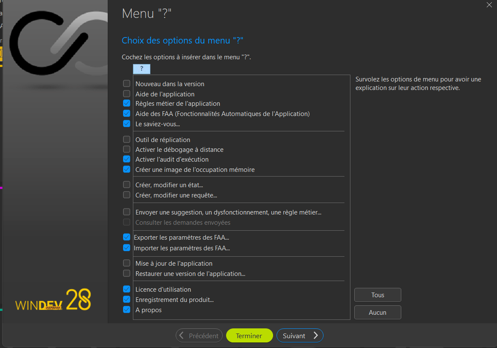

### Étape 7.5 – Résultat

Le tableau de bord du projet indique **3 fichiers de données, 11 fenêtres, 1 fenêtre interne et 6 états**.


---

## 8. Corriger les états

### Étape 8.1 – Lire les erreurs de compilation

8 **erreurs d'UI** (avertissements, aucune erreur bloquante) : « La hauteur du champ … est trop petite pour afficher correctement le libellé ». Les libellés d'en-tête des états générés sont trop longs pour leur cadre.

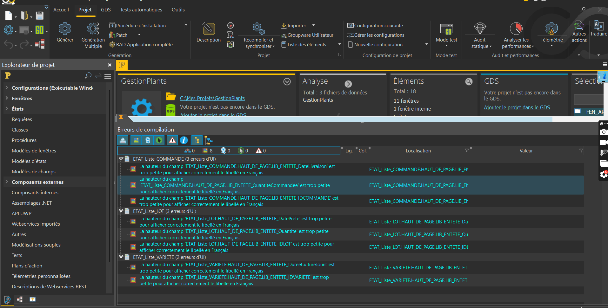

### Étape 8.2 – État des commandes avant correction

Double-clic sur une erreur : l'état s'ouvre sur le champ concerné (cadres orange). La colonne IDLOT dépasse aussi de la page.

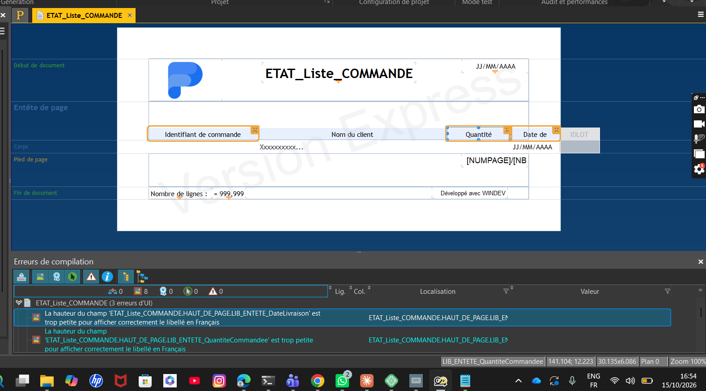

### Étape 8.3 – Raccourcir les libellés

Libellés raccourcis : **N° commande, Qté, Livraison**. Le visage triste reste : le problème est la **hauteur**, pas la largeur.

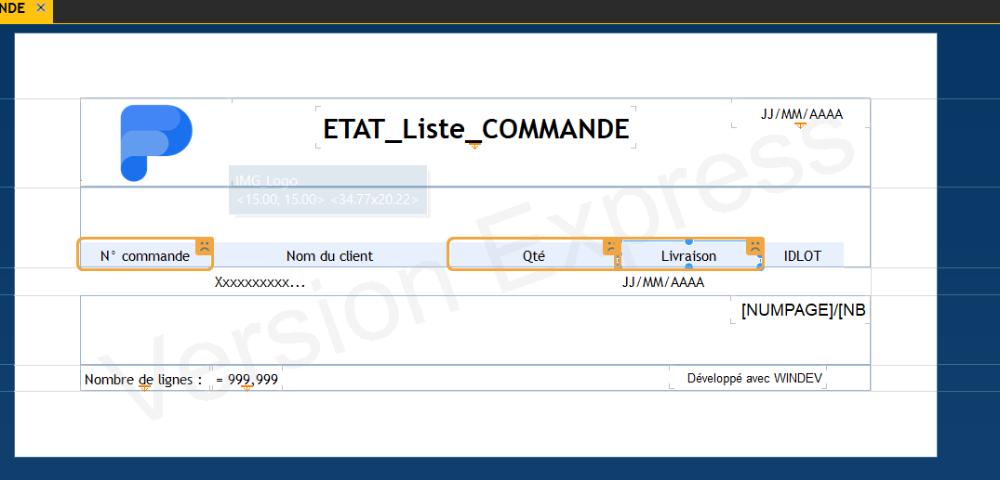

### Étape 8.4 – Agrandir et finaliser

Sélection des libellés signalés (Ctrl + clic), agrandissement en hauteur, titre renommé (« Liste des commandes clients ») puis élargi. Même travail sur l'état des lots (N° LOT, Qté, Livraison).


### Étape 8.5 – Recompiler

Onglet Projet → **Recompiler et synchroniser** → « Compilation terminée ».


---

## 9. Tester l'application

Bouton **GO** pour lancer l'application.

### Étape 9.1 – Lancement

Menu principal (Commandes clients, LOT, Variétés de plants) et « Astuce du jour » : l'export d'une table vers Excel ou Word est une **FAA**, disponible sans écrire de code.

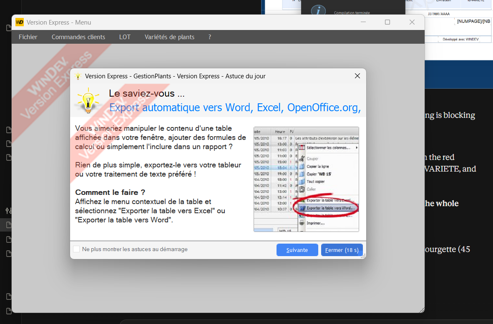

### Étape 9.2 – Ordre de saisie

La liste des variétés de la fiche LOT est vide tant qu'aucune variété n'existe : saisir d'abord les **variétés**, puis les **lots**, puis les **commandes**.

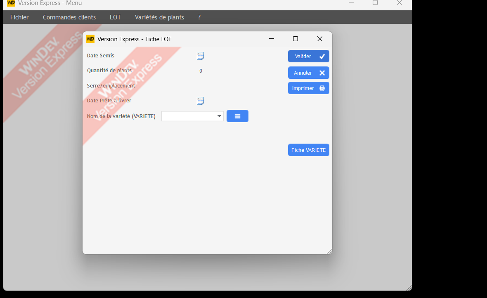

Données de test :

| Variété | Espèce | Durée (jours) |
| --- | --- | --- |
| Cœur de bœuf | Tomate | 60 |
| Batavia | Salade | 35 |
| Black Beauty | Courgette | 45 |

### Étape 9.3 – Fiche commande

La liste déroulante du lot affiche la **date de semis** : le RAD affiche la première rubrique lisible du fichier LOT. Le lien enregistré reste bien IDLOT. Amélioration : changer la « rubrique affichée » de la combo (onglet Contenu) en IDLOT.

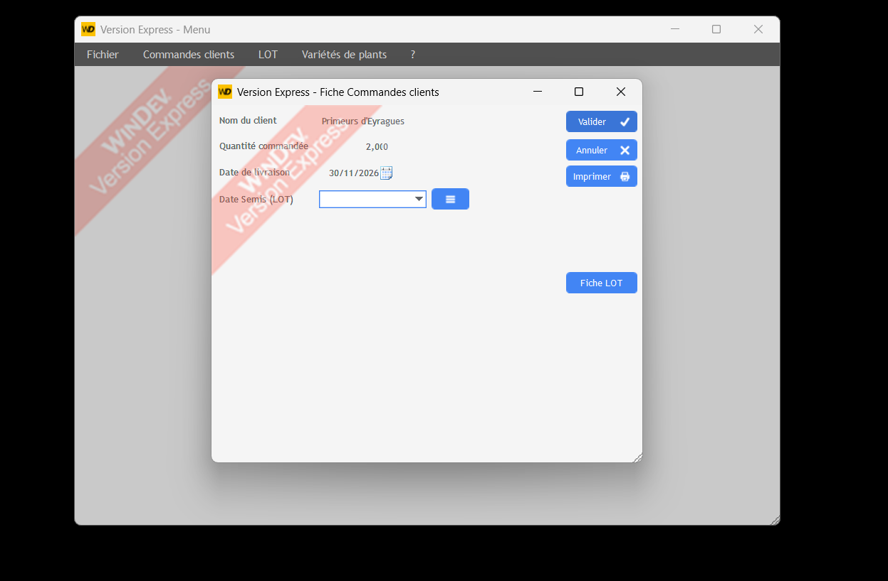

### Étape 9.4 – Tenter de supprimer une variété utilisée

Sélection de **Cœur de bœuf** (qui a un lot) → Supprimer → confirmation standard.

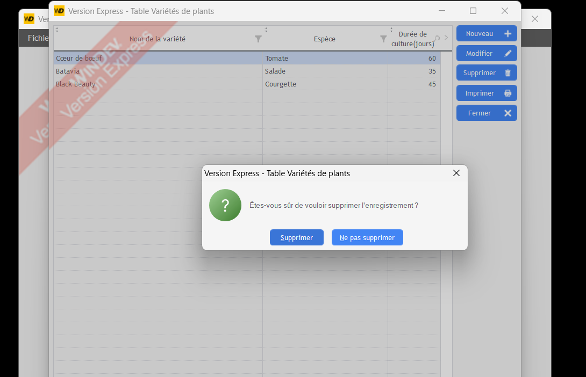

### Étape 9.5 – Intégrité respectée

HFSQL refuse la suppression : **« Intégrité non respectée »**. La règle définie dans l'analyse est appliquée par la base elle-même : aucun lot ne peut se retrouver sans variété.

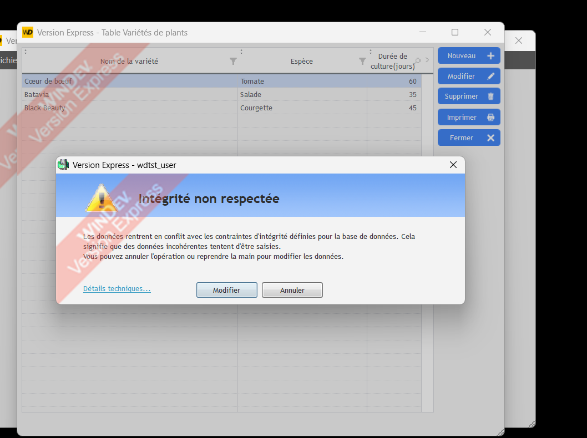

---

## 10. Ajouter le code métier

**Règle** : date prête = date de semis + durée de culture de la variété.
**Emplacement** : fenêtre fiche LOT, champ Date Semis, traitement « Sortie de SAI_DateSemis » (clic droit sur le champ → Code).

```wlanguage
// Calcule la date prête = date de semis + durée de culture de la variété
HLitRecherchePremier(VARIETE, IDVARIETE, COMBO_VARIETE)
SI HTrouve(VARIETE) ET SAI_DateSemis <> "" ALORS
	SAI_DatePrete = DateVersChaîne(EntierVersDate(DateVersEntier(SAI_DateSemis) + VARIETE.DureeCultureJours), "AAAAMMJJ")
FIN
```

| Fonction | Équivalent anglais | Rôle |
| --- | --- | --- |
| HLitRecherchePremier | HReadSeekFirst | Lit la variété choisie, par sa clé |
| HTrouve | HFound | Vérifie qu'elle a été trouvée |
| DateVersEntier | DateToInteger | Date → nombre de jours |
| EntierVersDate | IntegerToDate | Nombre de jours → date |
| DateVersChaîne | DateToString | Format AAAAMMJJ attendu par le champ |

Après modification : Ctrl+S, puis **GO**.

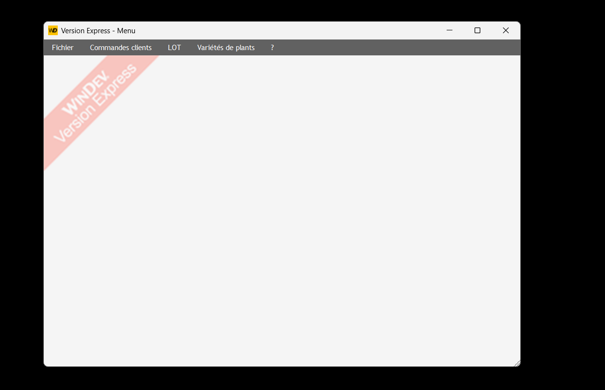

**Test** : Black Beauty (45 jours), semis le **20/10/2026** → date prête **04/12/2026**, calculée automatiquement.

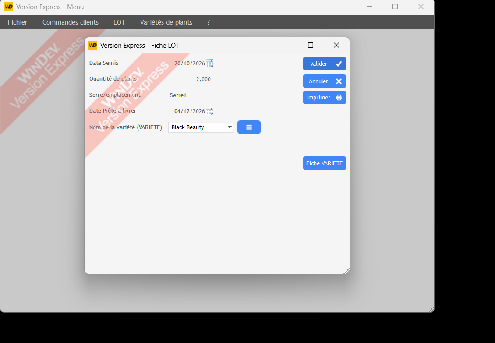

---

## 11. Bilan des tests

| Test | Données | Attendu | Obtenu | Capture |
| --- | --- | --- | --- | --- |
| Compilation | Projet complet | Aucune erreur bloquante | Conforme | 34 |
| Variétés | Cœur de bœuf 60 j, Batavia 35 j, Black Beauty 45 j | 3 variétés | Conforme | 38 |
| Commande | Primeurs d'Eyragues, 2 000 plants, 30/11/2026 | Rattachée à un lot | Conforme | 37 |
| Intégrité | Supprimer Cœur de bœuf (a un lot) | Refus | « Intégrité non respectée » | 39 |
| Calcul de date | Black Beauty, semis 20/10/2026 | 04/12/2026 | Conforme | 41 |
| FAA | Clic droit sur une table | Export Excel/Word | Disponible sans code | 35 |

---

## 12. Problèmes rencontrés et solutions

| Problème | Cause | Solution | Capture |
| --- | --- | --- | --- |
| « Waiting for printer connection » | Imprimante par défaut hors ligne | Microsoft Print to PDF par défaut | 02 |
| Fenêtre « Nouveau » au lieu de la création de fichier | Mauvais bouton après validation | Bouton « Nouveau fichier » du ruban Analyse | 15 |
| Fichier nommé « IDCOMMANDE » | Confusion nom du fichier / identifiant | Nom COMMANDE ; IDCOMMANDE créé automatiquement | 17 |
| Faute DateLiveraison | Saisie manuelle | Renommée DateLivraison | 18 |
| LOT en 0,1 au lieu de 1,1 | Réponse par défaut dans l'assistant | « Chaque lot a au moins une variété » → Oui | 19 |
| 8 erreurs d'UI | Libellés d'en-tête trop petits en hauteur | Libellés raccourcis et agrandis | 30–33 |
| Combo commande affichant une date | Le RAD affiche la 1re rubrique lisible (DateSemis) | Rubrique affichée → IDLOT (onglet Contenu) | 37 |
| Quantité « 2,000 » | Paramètres régionaux Windows en anglais | Normal (2 000) ; réglable dans le projet | 37 |
| Double-clic → « Sélection de champs » | Plusieurs champs encore sélectionnés | Annuler, cliquer dans le vide, double-cliquer un seul champ | – |

---

## 13. Améliorations possibles

- Procédure locale `CalculeDatePrete()` appelée aussi au changement de variété.
- Message d'intégrité clair pour l'utilisateur avec `HSurErreur`.
- Contrôle de la quantité restante d'un lot avant commande.
- Combo lisible : « N° lot – variété – serre ».
- HFSQL Client/Serveur pour le multi-postes.
- Écran WinDev Mobile de consultation d'un lot sur terminal Android.
- Projet sous GDS ou Git.
- Tableau de bord Power BI branché sur HFSQL via ODBC.
