# Documentation pas à pas – GestionPlants

[← Retour au README](../README.md) · [Glossaire](GLOSSAIRE.md)

## Sommaire

1. [Objectif](#1-objectif)
2. [Installation et activation](#2-installation-et-activation)
3. [Créer le projet](#3-créer-le-projet)
4. [Créer l'analyse et les fichiers](#4-créer-lanalyse-et-les-fichiers)
5. [Créer les liaisons](#5-créer-les-liaisons)
6. [Générer l'analyse](#6-générer-lanalyse)
7. [Générer l'application avec le RAD](#7-générer-lapplication-avec-le-rad)
8. [Corriger les états](#8-corriger-les-états)
9. [Ajouter le code métier](#9-ajouter-le-code-métier)
10. [Compiler et tester](#10-compiler-et-tester)
11. [Problèmes rencontrés et solutions](#11-problèmes-rencontrés-et-solutions)
12. [Améliorations possibles](#12-améliorations-possibles)

---

## 1. Objectif

Construire en une journée une petite application de gestion de production de plants maraîchers, pour prendre en main WinDev, WLangage et HFSQL :

- **Variétés** de plants et leur durée de culture.
- **Lots** semés, avec date prête à livrer calculée automatiquement.
- **Commandes clients** rattachées à un lot.

## 2. Installation et activation

WinDev Express est gratuit et sans limite de durée ; les applications créées se ferment après environ une heure (usage d'apprentissage uniquement).

1. Télécharger **WinDev Express** sur pcsoft.fr ou windev.com.
2. Installer avec les options par défaut, **en français**.
3. Activer au premier lancement :
   1. Copier l'identifiant affiché dans la fenêtre d'activation.
   2. Remplir le formulaire sur pcsoft.fr/pcsoft/demande/version-express.htm.
   3. Coller la clé reçue par e-mail, puis valider.
4. Si Windows affiche « Waiting for printer connection » : définir **Microsoft Print to PDF** comme imprimante par défaut (Paramètres, Imprimantes et scanners).

## 3. Créer le projet

Accueil → Nouveau → Projet.

| Écran de l'assistant | Choix | Pourquoi |
| --- | --- | --- |
| Plateforme | Exécutable Windows 32 bits, avec fenêtres | Fonctionne sur Windows 32 et 64 bits |
| Informations générales | GestionPlants, C:\Mes Projets\GestionPlants | Emplacement par défaut |
| Documents joints | Aucun | Possible d'y joindre un cahier des charges |
| Charte de programmation | Oui, charte Standard | Préfixes SAI_, COMBO_, FEN_ pour un code lisible |
| Charte graphique | Gabarit Phoenix | Style sobre et lisible |
| Internationalisation | Français seul | Application en français |
| Base de données | Oui, créer une nouvelle base | Ouvre l'assistant d'analyse |


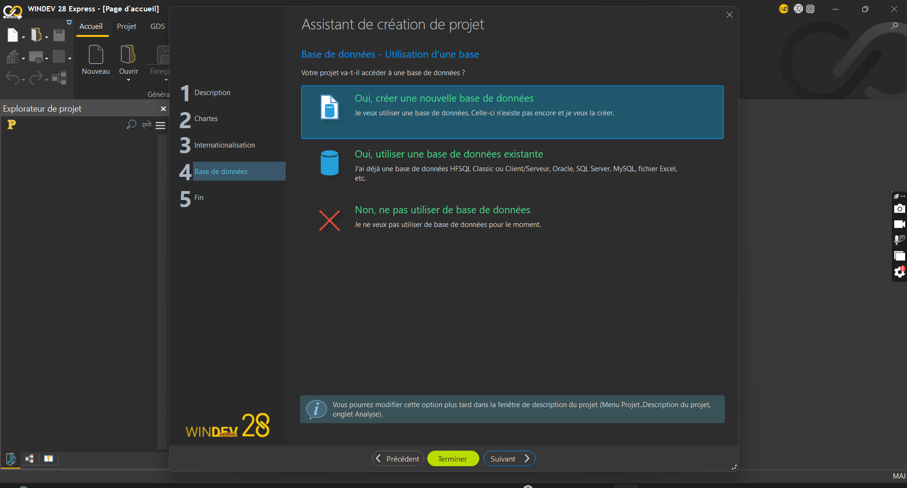

## 4. Créer l'analyse et les fichiers

Analyse **GestionPlants**, type **HFSQL Classic**, avec une description du rôle de chaque fichier.

Pour chaque fichier : onglet Analyse → Nouveau fichier → « Créer une nouvelle description », **identifiant automatique sur 8 octets** coché, puis une ligne par rubrique.

| Fichier | Rubrique | Type | Clé |
| --- | --- | --- | --- |
| VARIETE | IDVARIETE | Identifiant automatique (8 octets) | Clé unique |
| VARIETE | NomVariete | Texte 50 | Avec doublons |
| VARIETE | Espece | Texte 30 | Avec doublons |
| VARIETE | DureeCultureJours | Numérique entier (4 octets) | Non clé |
| LOT | IDLOT | Identifiant automatique (8 octets) | Clé unique |
| LOT | DateSemis | Date | Avec doublons |
| LOT | Quantite | Numérique entier | Non clé |
| LOT | Serre | Texte 20 | Avec doublons |
| LOT | DatePrete | Date | Avec doublons |
| COMMANDE | IDCOMMANDE | Identifiant automatique (8 octets) | Clé unique |
| COMMANDE | NomClient | Texte 50 | Avec doublons |
| COMMANDE | QuantiteCommandee | Numérique entier | Non clé |
| COMMANDE | DateLivraison | Date | Avec doublons |

> La clé étrangère (IDVARIETE dans LOT, IDLOT dans COMMANDE) n'est **pas** saisie à la main : la liaison la crée avec le bon type.

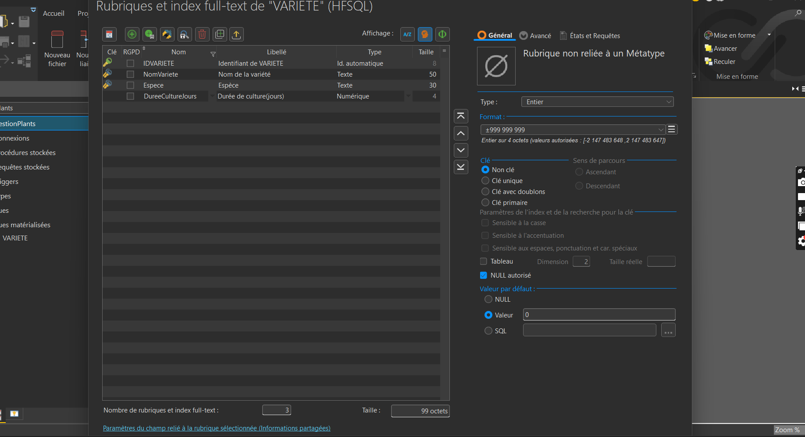

## 5. Créer les liaisons

Onglet Analyse → Nouvelle liaison → clic sur le fichier parent, puis sur le fichier enfant.

| Liaison | Parent | Enfant | Clé migrée | Règle d'intégrité |
| --- | --- | --- | --- | --- |
| Contrainte_VARIETE_LOT | VARIETE 0,n | LOT 1,1 | IDVARIETE | Suppression et modification interdites si des lots existent |
| Contrainte_LOT_COMMANDE | LOT 0,n | COMMANDE 1,1 | IDLOT | Suppression et modification interdites si des commandes existent |

Questions de l'assistant pour VARIETE → LOT :

| Question | Réponse |
| --- | --- |
| Chaque variété a au moins un lot ? | Non |
| Chaque variété peut avoir plusieurs lots ? | Oui |
| Chaque lot a au moins une variété ? | **Oui** |
| Chaque lot peut avoir plusieurs variétés ? | Non |

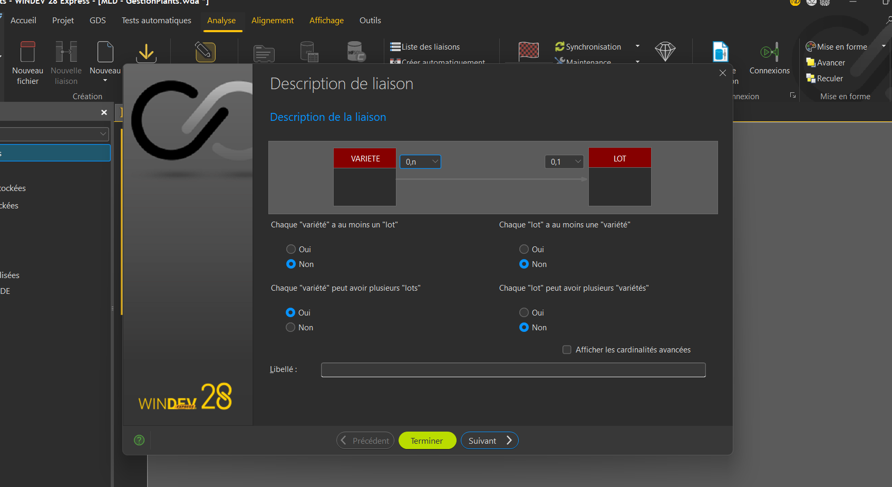

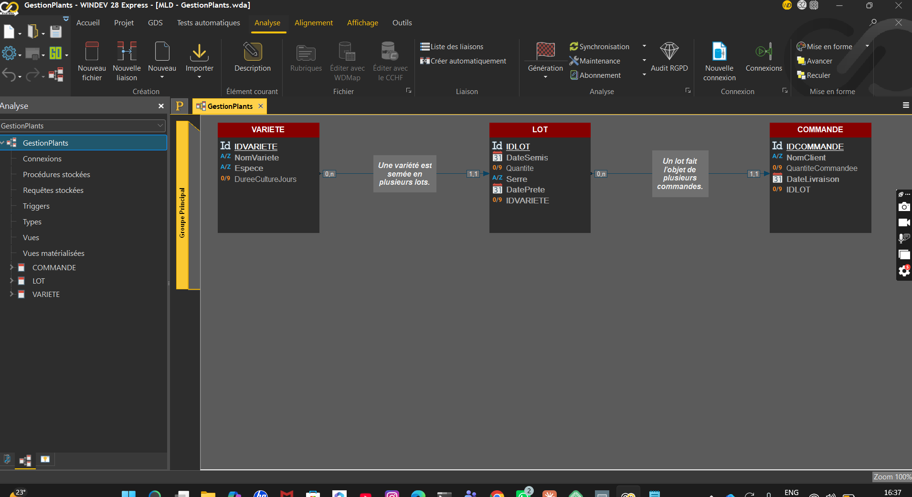

## 6. Générer l'analyse

Onglet Analyse → **Génération**. Le titre affiche « (v 1) » : chaque génération crée une version, utilisée pour mettre à jour les fichiers des utilisateurs (WDModFic).

## 7. Générer l'application avec le RAD

Onglet Projet → **RAD Application complète**.

1. Fichiers : VARIETE, LOT et COMMANDE cochés.
2. Points d'entrée : les trois fichiers (une entrée de menu chacun).
3. Mode de saisie : **tables en affichage seulement** ; la saisie passe par les fiches, comme dans un ERP.
4. Menu « ? » : options par défaut (aide, FAA, astuce du jour).

Résultat : **11 fenêtres, 1 fenêtre interne, 6 états** et un menu principal.

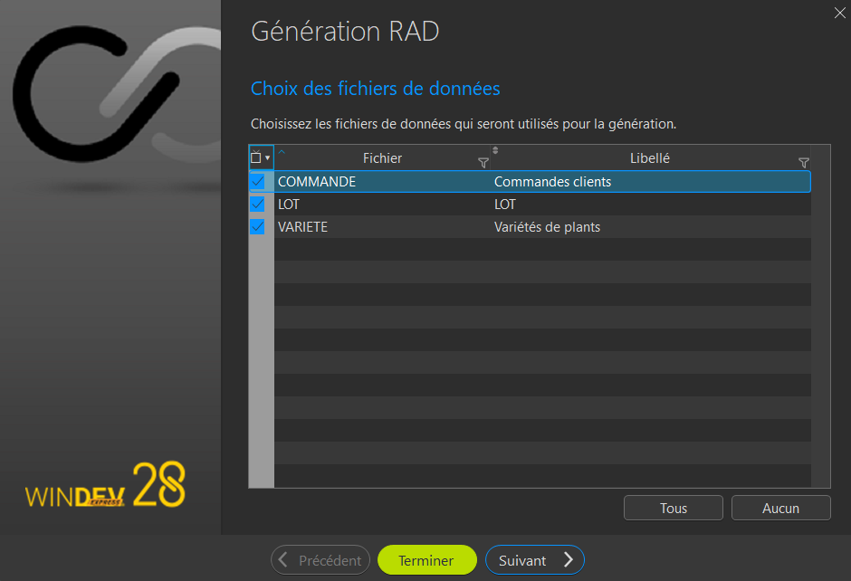
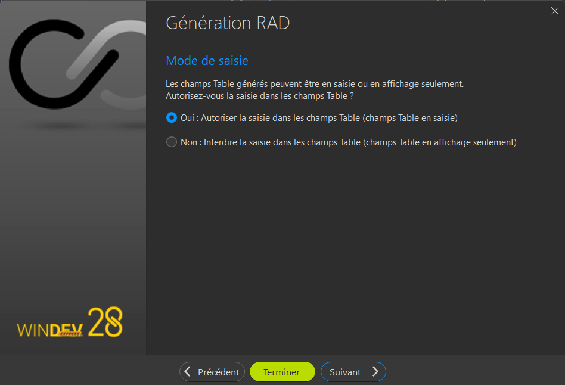
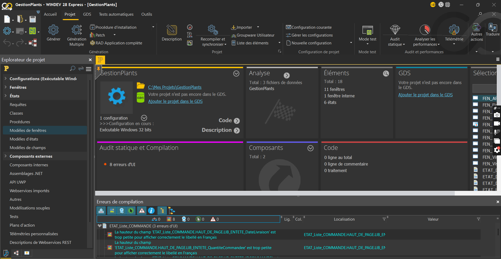

## 8. Corriger les états

Le compilateur signalait **8 erreurs d'UI** : libellés d'en-tête trop petits pour leur texte dans les états générés.

- Libellés raccourcis : N° commande, Qté, Livraison, N° LOT.
- Champs sélectionnés ensemble (Ctrl + clic) puis agrandis en hauteur.
- Titre renommé (« Liste des commandes clients ») puis élargi.

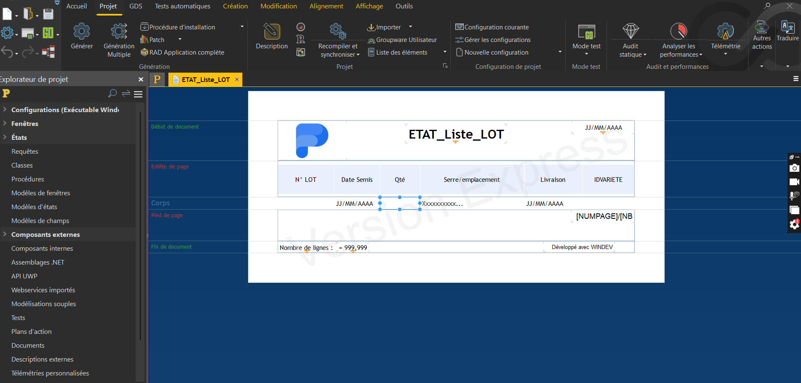

## 9. Ajouter le code métier

**Règle** : date prête = date de semis + durée de culture de la variété.
**Emplacement** : fiche LOT, champ Date Semis, traitement « Sortie de SAI_DateSemis ».

```wlanguage
// Calcule la date prête = date de semis + durée de culture de la variété
HLitRecherchePremier(VARIETE, IDVARIETE, COMBO_VARIETE)
SI HTrouve(VARIETE) ET SAI_DateSemis <> "" ALORS
	SAI_DatePrete = DateVersChaîne(EntierVersDate(DateVersEntier(SAI_DateSemis) + VARIETE.DureeCultureJours), "AAAAMMJJ")
FIN
```

| Fonction | Équivalent anglais | Rôle |
| --- | --- | --- |
| HLitRecherchePremier | HReadSeekFirst | Lit la variété choisie, par sa clé |
| HTrouve | HFound | Vérifie qu'elle a été trouvée |
| DateVersEntier | DateToInteger | Date → nombre de jours |
| EntierVersDate | IntegerToDate | Nombre de jours → date |
| DateVersChaîne | DateToString | Format AAAAMMJJ attendu par le champ |

## 10. Compiler et tester

Onglet Projet → **Recompiler et synchroniser** → « Compilation terminée ». Puis **GO**.

| Test | Données | Attendu | Obtenu |
| --- | --- | --- | --- |
| Compilation | Projet complet | Aucune erreur bloquante | Conforme |
| Variétés | Cœur de bœuf 60 j, Batavia 35 j, Black Beauty 45 j | 3 variétés | Conforme |
| Lot | Black Beauty, semis 20/10/2026, 2 000 plants, Serre 1 | Prête le 04/12/2026 | Conforme |
| Commande | Primeurs d'Eyragues, 2 000 plants, 30/11/2026 | Rattachée à un lot | Conforme |
| Intégrité | Supprimer Cœur de bœuf (a un lot) | Refus | « Intégrité non respectée » |
| FAA | Clic droit sur une table | Export Excel/Word | Disponible sans code |

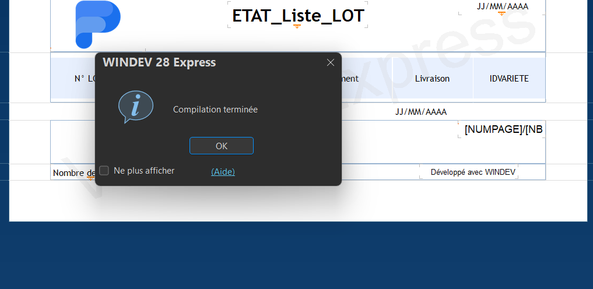
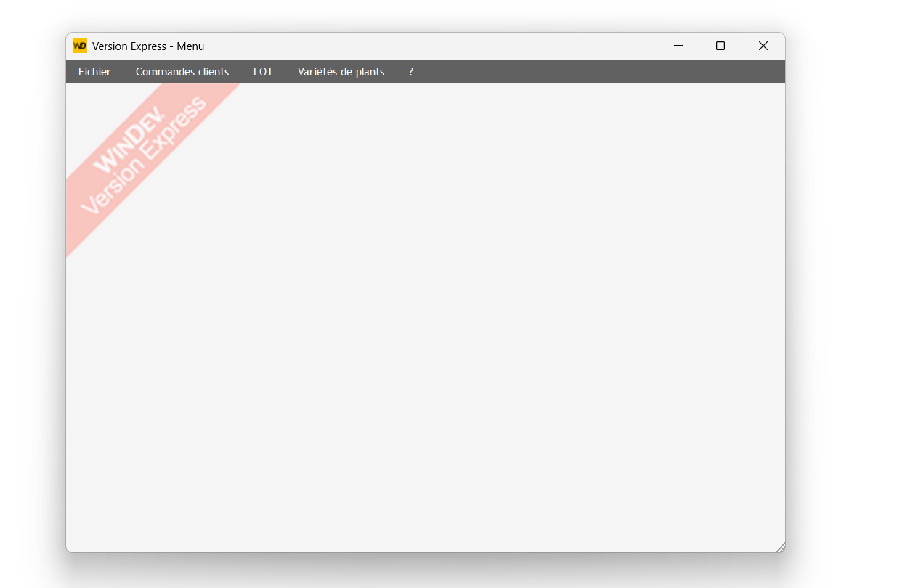
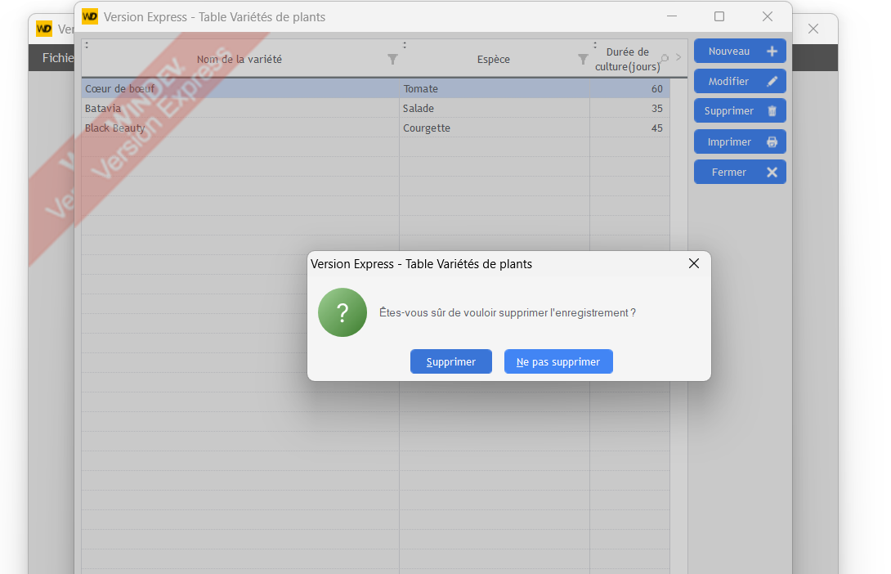
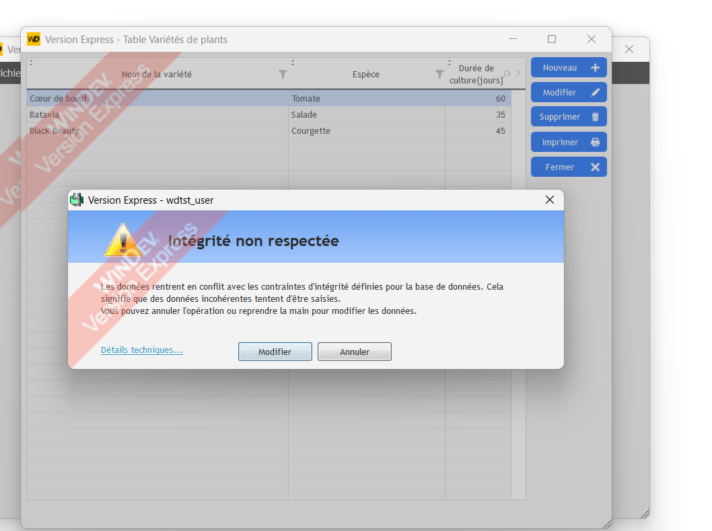
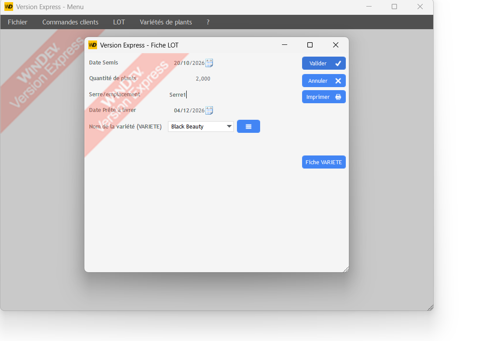

## 11. Problèmes rencontrés et solutions

| Problème | Cause | Solution |
| --- | --- | --- |
| « Waiting for printer connection » | Imprimante par défaut hors ligne | Microsoft Print to PDF par défaut |
| Fichier nommé « IDCOMMANDE » | Confusion nom du fichier / identifiant | Nom COMMANDE ; IDCOMMANDE créé automatiquement |
| Faute DateLiveraison | Saisie manuelle | Renommée DateLivraison |
| LOT en 0,1 au lieu de 1,1 | Mauvaise réponse dans l'assistant | « Chaque lot a au moins une variété » → Oui |
| 8 erreurs d'UI | Libellés d'en-tête trop petits | Libellés raccourcis et agrandis |
| Combo commande affichant une date | Le RAD affiche la 1re rubrique lisible (DateSemis) | Rubrique affichée → IDLOT (onglet Contenu) |
| Quantité « 2,000 » | Paramètres régionaux Windows en anglais | Normal (2 000) ; réglable dans le projet |
| Double-clic → « Sélection de champs » | Plusieurs champs sélectionnés | Annuler, cliquer dans le vide, double-cliquer un seul champ |

## 12. Améliorations possibles

- Procédure locale `CalculeDatePrete()` appelée aussi au changement de variété.
- Message d'intégrité clair avec `HSurErreur`.
- Contrôle de la quantité restante d'un lot avant commande.
- Combo lisible : « N° lot – variété – serre ».
- HFSQL Client/Serveur pour le multi-postes.
- Écran WinDev Mobile sur terminal Android.
- Projet sous GDS ou Git.
- Tableau de bord Power BI branché sur HFSQL via ODBC.
